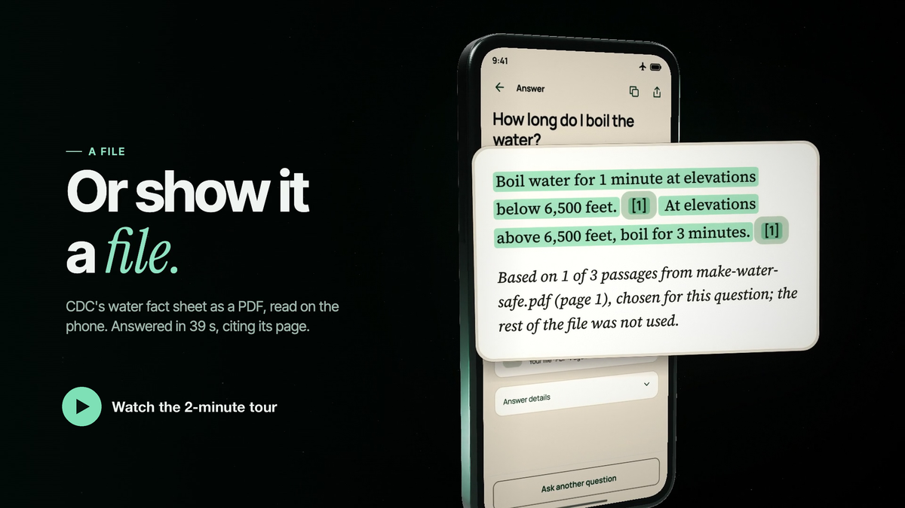

  

<h1 align="center">Field Atlas</h1>

Research, explore, and question the knowledge on your phone—even offline.

  <strong><a href="https://github.com/0x94t3z/fieldatlas/releases/download/v1.4.1/fieldatlas.apk">Download for Android</a></strong> ·
  <a href="#watch-it-work">Demo</a> ·
  <a href="#for-developers">Docs</a> ·
  <a href="https://github.com/0x94t3z/fieldatlas">Source</a>

  
  
  
  

<a href="https://github.com/0x94t3z/fieldatlas/releases/tag/v1.4.1">v1.4.1 · Release</a> · Works offline after setup · No account required

---

Field Atlas answers questions on your Android phone without an internet connection. You download
an answer model and the collections you want while you are online. After that, everything runs on
the phone. There is no account, search API, remote inference or Google Play Services requirement.
The app only goes online when you start a download or refresh the list of collections.

## What it can do

- **Look things up offline** in Wikipedia (English and Simple English), Wikivoyage travel guides,
  and collections on biology and cryptography.
- **Find places near you**, like a pharmacy, an ATM, a toilet or the best vegan restaurants in the
  city you are in, from OpenStreetMap and Wikivoyage.
- **Search 8.39 million passages on the phone.** The Encyclopedia and Biology collections are
  searched by [Leviathan](https://github.com/elstongun/leviathan), a search engine built into the
  app.
- **Show its sources.** When a collection covers your question, the answer cites the passages it
  used, and you can open each one.
- **Help in an emergency.** 42 first-aid and safety guides and the emergency numbers of 242
  countries are built in and work without any download.
- **Do some travel maths**, like fuel cost, currency at a given rate, time zones and water for a
  group, when the question is worded the way its calculators expect. Other word problems go to the
  model, which often gets them wrong (5 of 6 in the latest test).
- **Show phrases** from Wikivoyage phrasebooks, in the local script with pronunciation.

## Get started

You need an Android 13 or later phone with an arm64 processor.

1. [Download the app](https://github.com/0x94t3z/fieldatlas/releases/download/v1.4.1/fieldatlas.apk)
   (about 73 MB). You can check it against its
   [SHA-256 checksum](https://github.com/0x94t3z/fieldatlas/releases/download/v1.4.1/fieldatlas.apk.sha256).
2. Open the file and follow Android's prompts to install it.
3. In setup, download the answer model (1.4 GB).
4. Add any collections you want. You can add more later in **Library**.
5. Turn on airplane mode and ask a question in **Research**.

Finish the downloads before you go offline. A phone without a connection can import a `.fapack`
file copied from another device: collections from Hugging Face
([Knowledge Packs](https://huggingface.co/datasets/0x94t3z/fieldatlas-knowledge),
[Encyclopedia](https://huggingface.co/datasets/0x94t3z/fieldatlas-encyclopedia)), and the model as a
`.fapack` built as [MODELS.md](MODELS.md) describes. The [install guide](docs/installation.md) covers updates and older versions.

## How good is it?

The bounty asks for an offline tool that is more than half as good as a web search plus a
frontier AI model. We tested Field Atlas 1.4.1 on 60 new questions written after it was released,
by an AI model that had never seen the app's code, so the questions could not be tailored to what
the app already handles well. Other AI models then scored each answer blind, on its own, and scored
an answer researched on the web the same way. The result is Field Atlas's total as a share of the
web answer's.

- **29%** of the web-and-AI answers with the default model. **Not there yet.** 1.4.0 scored 34% on
  an earlier set of questions. On these questions 1.4.0 scores 28.6% and 1.4.1 29.7%, so the two
  versions are about even.
- **Strongest:** vegan restaurants in the city you are in (83%, 2 questions) and quick facts (58%,
  8 questions).
- **Weakest:** emergencies (10%), synthesis (11%), comparisons
  (13%) and reasoning with numbers (19%).

The graders and the reference answers come from AI models of one family, so treat these numbers as
our own measurement, not an independent score. Every question, answer and grade is published in
[docs/fieldtest/results-1.4.1](docs/fieldtest/results-1.4.1/heldout9.jsonl) (1.4.0's in
[docs/fieldtest/results-1.4.0](docs/fieldtest/results-1.4.0/)), and the
[evaluation](docs/evaluation.md#141-release-build-on-fresh-questions-october-15) explains the method
and the failures.

## Good to know

- Answers that use the model take **under a minute to about 4 minutes** on a 6 GB phone. Answers
  built from saved data take seconds.
- **Answers can be wrong.** Open the cited passages to check them. Nothing here is medical advice.
- Map listings, opening hours and menus can be out of date.
- Tested on a Redmi 13C (6 GB, Android 13) and an Infinix X6840 (4 GB, Android 16). Not yet tested
  on a Pixel, on GrapheneOS or on an 8 GB phone.

## Collections

All collections are optional and download inside the app from Hugging Face
([Knowledge Packs](https://huggingface.co/datasets/0x94t3z/fieldatlas-knowledge),
[Encyclopedia](https://huggingface.co/datasets/0x94t3z/fieldatlas-encyclopedia)).

| Collection | Download | What's inside |
| --- | ---: | --- |
| Encyclopedia | 10.64 GB (24.35 GB installed) | English and Simple English Wikipedia, 8.39 million passages |
| Travel guides | 290 MB (660 MB installed) | Wikivoyage guides by section, with phrasebooks |
| Travel places | 215 MB (650 MB installed) | Wikivoyage listings: sights, food, hotels, shops |
| Vegan places | 24 MB (77 MB installed) | OpenStreetMap places tagged vegan or with vegan options |
| Essentials | 986 MB (3.62 GB installed) | Pharmacies, hospitals, ATMs, toilets, water, stations and more from OpenStreetMap |
| Cryptography & Ethereum | 59 MB (92 MB installed) | Ethereum proposals and specifications, NIST post-quantum standards |
| Biology & longevity | 8 MB (27 MB installed) | A biology textbook, health topics, ageing gene data, six research reviews |

Sources, checksums and licences for each one are in [DATASETS.md](DATASETS.md#collections-the-app-offers).
The default model and every collection together take about 30.9 GB.

## Watch it work

A 2-minute narrated tour of v1.4.1, built from screen mockups that match the app: first-run
setup, then airplane mode, a pharmacy open now found by GPS, a snakebite question spoken aloud, and
a PDF answered with its page cited:

And an [unedited 35-second phone recording](docs/evidence/physical/infinix-x6840-android16/field-atlas-1.2.0-offline-berlin.mp4)
on a 4 GB Infinix in airplane mode: "best vegan restaurants in Berlin" returns six cited places in
10 seconds. The original public demo is on [Farcaster](https://farcaster.xyz/0x94t3z.eth/0x9538cba8).

## Versions

| Version | What changed |
| --- | --- |
| [1.4.1](https://github.com/0x94t3z/fieldatlas/releases/tag/v1.4.1) (latest) | Leviathan search in every collection, city-by-city place search, clearer progress and math, one answer model. [Release notes](docs/releases/current.md) |
| [1.4.0](https://github.com/0x94t3z/fieldatlas/releases/tag/v1.4.0) | One Encyclopedia, faster search on the phone, answers that cite their sources, a new Biology collection, simpler setup. [Notes](docs/releases/field-atlas-1.4.0.md) |
| [1.3.0](https://github.com/0x94t3z/fieldatlas/releases/tag/v1.3.0) | Emergency guides, open-now places, Word, PowerPoint and EPUB attachments. [Notes](docs/releases/field-atlas-1.3.0.md) |
| [1.2.1](https://github.com/0x94t3z/fieldatlas/releases/tag/v1.2.1) | Fixes for Xiaomi phones, the Essentials collection. [Notes](docs/releases/field-atlas-1.2.1.md) |
| [1.2.0](https://github.com/0x94t3z/fieldatlas/releases/tag/v1.2.0) | First collections, places near you, voice input. [Notes](docs/releases/field-atlas-1.2.0.md) |

A phone running a build signed with a different (test) key cannot be updated with the public APK.
Uninstalling removes saved answers, so keep that build if you need its data.

## Acknowledgements

Part of Field Atlas comes from a fork of this repository,
[vbuterin/fieldatlas](https://github.com/vbuterin/fieldatlas/tree/vector-search) (branch
`vector-search`, commits 337d334 to 769e85d, merged here in 4967a49). It added search across
several collections with vector search, answer history, background answers, voice input with a
bundled Vosk model, the pack-building tools, the first llama.cpp generation patch, and the
Biology & longevity pack that the app offered until 1.4.0. Later work builds on these parts.

Search in the Encyclopedia and Biology collections uses
[Leviathan](https://github.com/elstongun/leviathan) (Apache-2.0), compiled into the app from
pinned source. Answers are generated by [llama.cpp](https://github.com/ggml-org/llama.cpp) (MIT).
Every component and data source, with its licence, is listed in
[THIRD_PARTY_NOTICES.md](THIRD_PARTY_NOTICES.md).

## For developers

The app is native Kotlin and Jetpack Compose, with llama.cpp running the model on the phone and
SQLite plus Leviathan for search. Large model and collection files are not in this repository;
their sources and checksums are documented so they can be rebuilt and checked.

- [Build the Android app](docs/building.md)
- [Models](MODELS.md) and [collections](DATASETS.md)
- [Make your own `.fapack` collection](tools/README.md)
- [How it was tested](docs/verification.md)
