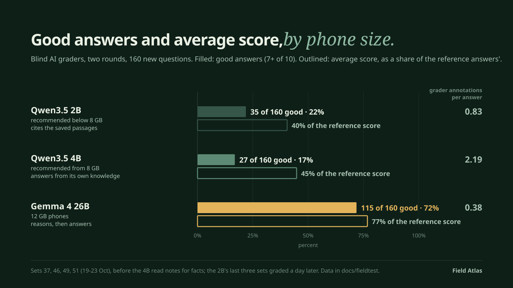

  <picture>
    <source media="(prefers-color-scheme: dark)" srcset="docs/branding/field-atlas-hero-dark.svg">
    <source media="(prefers-color-scheme: light)" srcset="docs/branding/field-atlas-hero-light.svg">
    
  </picture>

  <strong><a href="https://github.com/0x94t3z/fieldatlas/releases/download/v1.4.2/fieldatlas.apk">Download for Android</a></strong> ·
  <a href="#watch-it-work">Demo</a> ·
  <a href="#for-developers">Docs</a> ·
  <a href="https://github.com/0x94t3z/fieldatlas">Source</a>

  
  
  
  

<a href="https://github.com/0x94t3z/fieldatlas/releases/tag/v1.4.2">v1.4.2 · Release</a> · Works offline after setup · No account required

---

Field Atlas answers questions on your Android phone without an internet connection. You download
an answer model and the collections you want while you are online. After that, everything runs on
the phone. There is no account, search API, remote inference or Google Play Services requirement.
The app only goes online when you start a download or refresh the list of collections.

## What it can do

- **Look things up offline** in Wikipedia (English and Simple English), Wikivoyage travel guides,
  and collections on biology and cryptography.
- **Find places near you or near a landmark**, like a pharmacy, an ATM, a toilet, the best vegan
  restaurants in the city you are in, or a hospital near the Colosseum, from OpenStreetMap and
  Wikivoyage. Each place shows how far and which way, whether it is open, and an address large
  enough to show a driver; a list of hospitals names the nearest one with an emergency department.
- **Search 8.39 million passages on the phone.** The Encyclopedia and Biology collections are
  searched by [Leviathan](https://github.com/elstongun/leviathan), a search engine built into the
  app.
- **Show its sources.** When a collection covers your question, the answer cites the passages it
  used, and you can open each one.
- **Keep a conversation going.** Ask a follow-up under an answer, by typing, speaking or adding a
  file, and pick a topic up again later from History.
- **Read answers aloud** with the phone's voice or a natural voice you can download once.
- **Help in an emergency.** 51 first-aid and safety guides, each with a recorded reading, and the
  emergency numbers of 242 countries are built in and work without any download. The call line and
  the official guide open in seconds, even while another answer is being written. With Gemma 4 26B in
  use on a 12 GB phone, and not busy with another answer, it then writes for your situation.
- **Do some travel maths**, like fuel cost, currency at a given rate, time zones and water for a
  group, when the question is worded the way its calculators expect. A word problem that gives its
  own figures is worked from them; the model still gets some of these wrong.
- **Show phrases** from Wikivoyage phrasebooks, in the local script with pronunciation.

## How it works

A question the app can answer exactly, such as an emergency number, a first-aid guide, a sum or the
nearest pharmacy, is answered by the app itself in seconds. Everything else is searched in the
saved collections and written by the model your phone can hold. A subject few people write about,
or one held by a specialist or imported collection, is read from the saved passages and cited, and so
is a question for a single fact on Qwen3.5 4B. Figures are then checked against those passages, and the sources sit
under the answer. [How it works, step by step](docs/how-it-works.md).

## Get started

You need an Android 13 or later phone with an arm64 processor.

1. [Download the app](https://github.com/0x94t3z/fieldatlas/releases/download/v1.4.2/fieldatlas.apk)
   (about 100 MB). You can check it against its
   [SHA-256 checksum](https://github.com/0x94t3z/fieldatlas/releases/download/v1.4.2/fieldatlas.apk.sha256).
2. Open the file and follow Android's prompts to install it.
3. In setup, download the answer model it recommends: Qwen3.5 2B (1.4 GB) on phones with less than
   8 GB of memory, Qwen3.5 4B (3.0 GB) from 8 GB, or Gemma 4 26B (10.5 GB) on a 12 GB phone. A 6 GB
   phone can choose the 4B too; setup says it is slow there.
4. Add any collections you want. You can add more later in **Library**.
5. Turn on airplane mode and ask a question in **Research**.

Finish the downloads before you go offline. A phone without a connection can import a `.fapack`
file copied from another device: collections from Hugging Face
([Knowledge Packs](https://huggingface.co/datasets/0x94t3z/fieldatlas-knowledge),
[Encyclopedia](https://huggingface.co/datasets/0x94t3z/fieldatlas-encyclopedia)), and the model's own
`.gguf` file, or a `.fapack` built as [MODELS.md](MODELS.md) describes, through **Import a file**. The [install guide](docs/installation.md) covers updates and older versions.

## How good is it?

We count how many questions get a **good answer** and how many problems the graders list per answer (**grader annotations**).
Each question set is written blind and sealed before the app answers it. AI graders then score every
answer from 0 to 10, without knowing which setup wrote it, usually in two rounds; web-researched
reference answers are graded the same way as a yardstick. A good answer is one they score 7 or more in
every round. Changes to how answers are written are tested this way; the fixes of October 24 (emergencies,
the model recommended per phone, wording) were checked on the phone, not on a fresh graded set.

- **Gemma 4 26B, on 12 GB phones:** a good answer to 115 of 160 new questions (72%) over four sealed
  sets (37, 46, 49 and 51, answered 19 to 23 October: 27, 29, 25 and 34 of 40), 77% of the reference
  answers' average score, with 0.38 grader annotations per answer. It reasons first, then answers from
  what it knows.
- **Qwen3.5 4B, recommended from 8 GB (a 6 GB phone can choose it):** 27 of 160 (17%; 8, 6, 5 and 8 of 40),
  45% of the reference score, with 2.19 grader annotations per answer. It answers from what it knows, so
  its answers are fuller but have more details to check; fewer of them reach 7 in every round, while its
  average score is higher than the 2B's. The passages found are listed under each answer to check it. Since those sets were graded it reads
  three saved notes for a question about a single fact, which took it from 38 to 66 good answers on 105 earlier sealed fact questions (36% to 63%; graded with
  the two answers side by side), with grader annotations per answer down from 2.79 to 1.69.
- **Qwen3.5 2B, recommended below 8 GB:** 35 of 160 (22%; 2, 11, 9 and 13 of 40), 40% of the reference
  score, with 0.83 grader annotations per answer; its answers to sets 46, 49 and 51 were graded a day
  after the others. It writes from the saved passages and cites them when its draft passes the check and
  review, and otherwise gives a model explanation labelled as unverified (18 of its 40 answers on set 37).
  On sets 46 to 51 it was good on single facts the collections hold (22 of 32) and poor at explanations
  (1 of 22).
- **Emergencies:** on 40 new first-aid situations (set 55), Gemma 4 26B writing from the official
  guide gave a good answer to 30, one judged unsafe; the smaller models show the guide as published,
  with the call line first. On 320 labelled questions, which the guide matcher was developed against, the
  right guide opens 231 times with none misleading (the release's code).
- **Saved sources add good answers.** The rebuilt Biology collection took the 2B from 2 to 6 good
  answers (5% to 15%) on 40 longevity questions (18 October); reading the Encyclopedia for subjects few
  people write about took the 4B from 2 to 7 (5% to 18%) on 40 such questions (20 October, one grading
  round); reading notes for single facts took it from 38 to 66 of 105 (23 October)
  ([how it works](docs/how-it-works.md)).

Every test behind 1.4.2, including emergencies and the phone checks, is on one page:
[How Field Atlas 1.4.2 was tested](docs/testing-1.4.2.md). These are desktop runs of the app's own answering code. Gemma has been timed only on an Android
emulator, not on a 12 GB phone. The graders and the reference answers come from AI models of one
family, so treat these numbers as our own measurement, not an independent score; the share of the
reference score is a judge's average, not a share of correct answers, and none of these numbers shows
that the bounty's bar is met: that is for the judges. The questions and grades are
published in [docs/fieldtest](docs/fieldtest/) (for some sets the grades only), and the
[evaluation](docs/evaluation.md) explains each test, including changes that were tried and not
adopted.

## Good to know

- **Speed, from asking to the complete answer**, on a 6 GB Redmi 13C in airplane mode (October 24,
  [six questions](docs/testing-1.4.2.md#on-the-phone-and-the-emulator), three simple and three
  complex, each asked twice): Qwen3.5 2B took 88 to 153 seconds for simple questions and 195 to 351
  seconds for explanations, comparisons and trip plans. Qwen3.5 4B took 3 to 6 minutes, and one answer
  took 47 minutes with Wi-Fi on and other apps open, which is why the 2B is recommended below 8 GB.
  Gemma 4 26B answered in a median of 92 seconds on a 12 GB emulator, which runs at a computer's speed,
  not a phone's. No 8 GB or 12 GB phone has been measured. Answers built from saved data (first-aid
  guides, emergency numbers, places, sums) take seconds; a first-aid guide, an emergency number or the
  no-guide reply also never waits for another answer to finish.
- **Answers can be wrong.** Open the cited passages to check them. Nothing here is medical advice.
- **No live data.** The models and collections are snapshots; a question about this year's events
  or today's prices can get an out-of-date answer that does not say so.
- Map listings, opening hours and menus can be out of date.
- **Within the bounty's limits:** with all three models, every collection and the voice installed,
  Android reports 47.58 GB of storage for the app on a 12 GB Android emulator (October 21); there, in
  airplane mode, it used at most 6.8 GB of memory while answering with the 4B (October 18, on an earlier 1.4.2 build)
  ([details](docs/evaluation.md#good-answers-and-storage-with-everything-installed-october-21)).
- Tested on a Redmi 13C (6 GB, Android 13) with builds signed with a local test key, the latest one
  without this release's two screen-reader labels, and on Android emulators. On a fresh emulator with no
  Google apps, the previous release file was set up only through the app and answered offline, and this
  release file was installed over it, data kept, and answered offline. Not yet tested on a Pixel, on
  GrapheneOS, or on a real 8 GB or 12 GB phone.

## Collections

All collections are optional and download inside the app from Hugging Face
([Knowledge Packs](https://huggingface.co/datasets/0x94t3z/fieldatlas-knowledge),
[Encyclopedia](https://huggingface.co/datasets/0x94t3z/fieldatlas-encyclopedia)).

| Collection | Download | What's inside |
| --- | ---: | --- |
| Encyclopedia | 10.64 GB (24.35 GB installed) | English and Simple English Wikipedia, 8.39 million passages |
| Travel guides | 290 MB (660 MB installed) | Wikivoyage guides by section, with phrasebooks |
| Travel places | 215 MB (650 MB installed) | Wikivoyage listings: sights, food, hotels, shops |
| Vegan places | 24 MB (77 MB installed) | OpenStreetMap places tagged vegan or with vegan options |
| Essentials | 986 MB (3.62 GB installed) | Pharmacies, hospitals, ATMs, toilets, water, stations and more from OpenStreetMap |
| Cryptography & Ethereum | 59 MB (92 MB installed) | Ethereum proposals and specifications, NIST post-quantum standards |
| Biology & longevity | 1.08 GB (2.86 GB installed) | 48,286 open-access ageing and longevity papers, a biology textbook, health and genetics summaries, ageing databases |

Sources, checksums and licences for each one are in [DATASETS.md](DATASETS.md#collections-the-app-offers).
The default model and every collection together take about 33.7 GB.

## Watch it work

A 2-minute narrated tour of v1.4.1, built from screen mockups that match the app: first-run
setup, then airplane mode, a pharmacy open now found by GPS, a snakebite question spoken aloud, and
a PDF answered with its page cited:

And an [unedited 35-second phone recording](docs/evidence/physical/infinix-x6840-android16/field-atlas-1.2.0-offline-berlin.mp4)
on a 4 GB Infinix in airplane mode: "best vegan restaurants in Berlin" returns six cited places in
10 seconds. The original public demo is on [Farcaster](https://farcaster.xyz/0x94t3z.eth/0x9538cba8).

## Versions

| Version | What changed |
| --- | --- |
| [1.4.2](https://github.com/0x94t3z/fieldatlas/releases/tag/v1.4.2) (latest) | Follow-up questions, topics in History, answers that keep going off the screen, read aloud, answers from the model's own knowledge with Qwen3.5 4B (recommended from 8 GB) and Gemma 4 26B on 12 GB phones, first aid with the call line first and 51 guides, any model file importable. [Release notes](docs/releases/current.md) |
| [1.4.1](https://github.com/0x94t3z/fieldatlas/releases/tag/v1.4.1) | Leviathan search in every collection, city-by-city place search, clearer progress and math, one answer model. [Notes](docs/releases/field-atlas-1.4.1.md) |
| [1.4.0](https://github.com/0x94t3z/fieldatlas/releases/tag/v1.4.0) | One Encyclopedia, faster search on the phone, answers that cite their sources, a new Biology collection, simpler setup. [Notes](docs/releases/field-atlas-1.4.0.md) |
| [1.3.0](https://github.com/0x94t3z/fieldatlas/releases/tag/v1.3.0) | Emergency guides, open-now places, Word, PowerPoint and EPUB attachments. [Notes](docs/releases/field-atlas-1.3.0.md) |
| [1.2.1](https://github.com/0x94t3z/fieldatlas/releases/tag/v1.2.1) | Fixes for Xiaomi phones, the Essentials collection. [Notes](docs/releases/field-atlas-1.2.1.md) |
| [1.2.0](https://github.com/0x94t3z/fieldatlas/releases/tag/v1.2.0) | First collections, places near you, voice input. [Notes](docs/releases/field-atlas-1.2.0.md) |

A phone running a build signed with a different (test) key cannot be updated with the public APK.
Uninstalling removes saved answers, so keep that build if you need its data.

## Acknowledgements

Part of Field Atlas comes from a fork of this repository,
[vbuterin/fieldatlas](https://github.com/vbuterin/fieldatlas/tree/vector-search) (branch
`vector-search`, commits 337d334 to 769e85d, merged here in 4967a49). It added search across
several collections with vector search, answer history, background answers, voice input with a
bundled Vosk model, the pack-building tools, the first llama.cpp generation patch, and the
Biology & longevity pack that the app offered until 1.4.0. Later work builds on these parts.

Search in the Encyclopedia and Biology collections uses
[Leviathan](https://github.com/elstongun/leviathan) (Apache-2.0), compiled into the app from
pinned source. Answers are generated by [llama.cpp](https://github.com/ggml-org/llama.cpp) (MIT).
Every component and data source, with its licence, is listed in
[THIRD_PARTY_NOTICES.md](THIRD_PARTY_NOTICES.md).

## For developers

The app is native Kotlin and Jetpack Compose, with llama.cpp running the model on the phone and
SQLite plus Leviathan for search. Large model and collection files are not in this repository;
their sources and checksums are documented so they can be rebuilt and checked.

- [Build the Android app](docs/building.md)
- [Models](MODELS.md) and [collections](DATASETS.md)
- [Make your own `.fapack` collection](tools/README.md)
- [How it was tested](docs/verification.md)
