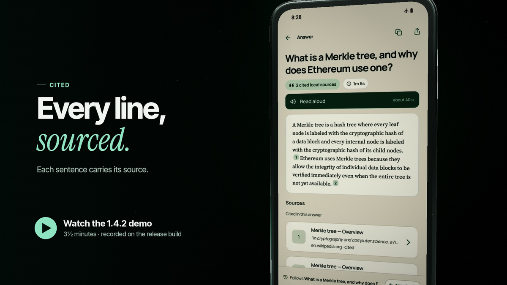

  <picture>
    <source media="(prefers-color-scheme: dark)" srcset="docs/branding/field-atlas-hero-dark.svg">
    <source media="(prefers-color-scheme: light)" srcset="docs/branding/field-atlas-hero-light.svg">
    
  </picture>

  <strong><a href="https://github.com/0x94t3z/fieldatlas/releases/download/v1.4.3/fieldatlas.apk">Download for Android</a></strong> ·
  <a href="#watch-it-work">Demo</a> ·
  <a href="#for-developers">Docs</a> ·
  <a href="https://github.com/0x94t3z/fieldatlas">Source</a>

  
  
  
  

<a href="https://github.com/0x94t3z/fieldatlas/releases/tag/v1.4.3">v1.4.3 · Release</a> · Works offline after setup · No account required

---

Field Atlas answers questions on your Android phone without an internet connection. You download
an answer model and the collections you want while you are online. After that, everything runs on
the phone. There is no account, search API, remote inference or Google Play Services requirement.
The app only goes online when you start a download or refresh the list of collections.

## What it can do

- **Look things up offline** in Wikipedia, Wikivoyage, and collections on biology and cryptography:
  8.39 million passages, searched on the phone by [Leviathan](https://github.com/elstongun/leviathan).
- **Show its sources.** Answers cite the passages they use, and you can open each one.
- **Find places** near you or near a landmark, like a pharmacy, an ATM or a hospital, with distance,
  direction and opening hours, from OpenStreetMap and Wikivoyage.
- **Help in an emergency.** 52 official first-aid guides and the emergency numbers of 242 countries
  are built in. They open in seconds, with the call line first.
- **Keep a conversation going.** Ask a follow-up by typing, speaking or adding a file, and pick a
  topic up later from History.
- **Read answers aloud** with the phone's voice or a natural voice.
- **Do travel maths** (fuel, currency, time zones) and show Wikivoyage phrases with pronunciation.

## How it works

Questions with an exact answer, like an emergency number, a first-aid guide, a sum or the nearest
pharmacy, are answered by the app itself in seconds. Everything else is searched in your saved
collections and written by the model on your phone, with its sources underneath.
[Step by step](docs/how-it-works.md).

## Get started

You need an Android 13 or later phone with an arm64 processor.

1. [Download the app](https://github.com/0x94t3z/fieldatlas/releases/download/v1.4.3/fieldatlas.apk)
   (about 100 MB, [SHA-256](https://github.com/0x94t3z/fieldatlas/releases/download/v1.4.3/fieldatlas.apk.sha256)).
2. Open it and follow Android's prompts to install it.
3. In setup, download the model it recommends: Qwen3.5 2B (1.4 GB) below 8 GB of memory, or
   Qwen3.5 4B (3.0 GB) from 8 GB.
4. Add the collections you want. You can add more later in **Library**.
5. Turn on airplane mode and ask a question in **Research**.

No connection? Copy a collection (`.fapack`) or the model file (`.gguf`) from another device and
choose **Import a file**. Collections are on Hugging Face:
[Knowledge Packs](https://huggingface.co/datasets/0x94t3z/fieldatlas-knowledge) and
[Encyclopedia](https://huggingface.co/datasets/0x94t3z/fieldatlas-encyclopedia). The
[install guide](docs/installation.md) covers updates; [MODELS.md](MODELS.md) covers model files.

## How good is it?

We write new questions, seal them, and have AI graders score each answer from 0 to 10 without knowing
which model wrote it. A **good answer** scores 7 or more in every round.

| Model | Good answers, 160 sealed questions | Problems noted per answer |
| --- | ---: | ---: |
| Qwen3.5 2B | 35 (22%) | 0.83 |
| Qwen3.5 4B | 27 (17%) | 2.19 |
| Gemma 4 26B, no longer offered | 115 (72%) | 0.38 |

- **The 2B** writes from your saved passages and cites them. It is good at facts the collections hold
  and weak at explanations.
- **The 4B** answers from what it knows, so its answers are fuller but have more to check. For a
  single fact it reads the Encyclopedia first, which raised it from 38 to 66 good answers on 105 fact
  questions.
- **Emergencies.** In 1.4.3 the right guide opened for 59 of 90 new messages about bleeding, electric
  shocks and look-alikes, up from 37.

These are our own measurements, not an independent score. The questions and grades are in
[docs/fieldtest](docs/fieldtest/) (for some sets, the grades only); [how 1.4.2 was tested](docs/testing-1.4.2.md) and the
[evaluation](docs/evaluation.md) explain each test.

## Good to know

- **Speed.** On a 6 GB Redmi 13C, an answer takes about 1½ to 6 minutes with the 2B and 3 to 6
  minutes with the 4B. Guides, emergency numbers, places and sums take seconds.
  ([Timings](docs/testing-1.4.2.md#on-the-phone-and-the-emulator).)
- **Answers can be wrong.** Check the cited passages. Nothing here is medical advice.
- **No live data.** Models and collections are snapshots, so news, prices and opening hours can be
  out of date.
- **Storage.** The 2B with every collection takes about 34 GB.
- **Tested on** a 6 GB Redmi 13C (Android 13) and Android emulators; 1.4.3 on an emulator only. Not
  yet on a Pixel, GrapheneOS, or a real 8 GB or 12 GB phone.

## Collections

All collections are optional and download inside the app from Hugging Face
([Knowledge Packs](https://huggingface.co/datasets/0x94t3z/fieldatlas-knowledge),
[Encyclopedia](https://huggingface.co/datasets/0x94t3z/fieldatlas-encyclopedia)).

| Collection | Download | What's inside |
| --- | ---: | --- |
| Encyclopedia | 10.64 GB (24.35 GB installed) | English and Simple English Wikipedia, 8.39 million passages |
| Travel guides | 290 MB (660 MB installed) | Wikivoyage guides by section, with phrasebooks |
| Travel places | 215 MB (650 MB installed) | Wikivoyage listings: sights, food, hotels, shops |
| Vegan places | 24 MB (77 MB installed) | OpenStreetMap places tagged vegan or with vegan options |
| Essentials | 986 MB (3.62 GB installed) | Pharmacies, hospitals, ATMs, toilets, water, stations and more from OpenStreetMap |
| Cryptography & Ethereum | 59 MB (92 MB installed) | Ethereum proposals and specifications, NIST post-quantum standards |
| Biology & longevity | 1.08 GB (2.86 GB installed) | 48,286 open-access ageing and longevity papers, a biology textbook, health and genetics summaries, ageing databases |

Sources, checksums and licences for each one are in [DATASETS.md](DATASETS.md#collections-the-app-offers).
The default model and every collection together take about 33.7 GB.

## Watch it work

**[Watch the 1.4.2 demo on X](https://x.com/0x94t3z/status/2114251259222134898)** (3½ minutes, narrated). Recorded
from the 1.4.2 release build on Android emulators in airplane mode:

- first-run setup, and the model offered for 4, 6, 8 and 12 GB of memory
- a typed question answered with cited sources, then a follow-up
- Read aloud in the app's own voice
- a first-aid question spoken aloud
- a PDF read on the phone
- Library and History

Waits for the model are sped up, and each one is labelled with its real time.

Also: an [unedited phone recording](docs/evidence/physical/infinix-x6840-android16/field-atlas-1.2.0-offline-berlin.mp4)
of version 1.2.0 on a 4 GB Infinix in airplane mode, and the [first public demo](https://farcaster.xyz/0x94t3z.eth/0x9538cba8) on Farcaster.

## Versions

| Version | What changed |
| --- | --- |
| [1.4.3](https://github.com/0x94t3z/fieldatlas/releases/tag/v1.4.3) (latest) | A safety update: severe bleeding and electric shocks find their guide as people describe them, a new CDC electric shock guide (52 guides), the first step even when no guide fits, and Gemma 4 26B no longer offered. [Release notes](docs/releases/current.md) |
| [1.4.2](https://github.com/0x94t3z/fieldatlas/releases/tag/v1.4.2) | Follow-up questions, topics in History, answers that keep going off the screen, read aloud, answers from the model's own knowledge with Qwen3.5 4B (recommended from 8 GB) and Gemma 4 26B on 12 GB phones, first aid with the call line first and 51 guides, any model file importable. [Notes](docs/releases/field-atlas-1.4.2.md) |
| [1.4.1](https://github.com/0x94t3z/fieldatlas/releases/tag/v1.4.1) | Leviathan search in every collection, city-by-city place search, clearer progress and math, one answer model. [Notes](docs/releases/field-atlas-1.4.1.md) |
| [1.4.0](https://github.com/0x94t3z/fieldatlas/releases/tag/v1.4.0) | One Encyclopedia, faster search on the phone, answers that cite their sources, a new Biology collection, simpler setup. [Notes](docs/releases/field-atlas-1.4.0.md) |
| [1.3.0](https://github.com/0x94t3z/fieldatlas/releases/tag/v1.3.0) | Emergency guides, open-now places, Word, PowerPoint and EPUB attachments. [Notes](docs/releases/field-atlas-1.3.0.md) |
| [1.2.1](https://github.com/0x94t3z/fieldatlas/releases/tag/v1.2.1) | Fixes for Xiaomi phones, the Essentials collection. [Notes](docs/releases/field-atlas-1.2.1.md) |
| [1.2.0](https://github.com/0x94t3z/fieldatlas/releases/tag/v1.2.0) | First collections, places near you, voice input. [Notes](docs/releases/field-atlas-1.2.0.md) |

A phone running a build signed with a different (test) key cannot be updated with the public APK.
Uninstalling removes saved answers, so keep that build if you need its data.

## Acknowledgements

Part of Field Atlas comes from a fork of this repository,
[vbuterin/fieldatlas](https://github.com/vbuterin/fieldatlas/tree/vector-search) (branch
`vector-search`, commits 337d334 to 769e85d, merged here in 4967a49). It added search across
several collections with vector search, answer history, background answers, voice input with a
bundled Vosk model, the pack-building tools, the first llama.cpp generation patch, and the
Biology & longevity pack that the app offered until 1.4.0. Later work builds on these parts.

Search in the Encyclopedia and Biology collections uses
[Leviathan](https://github.com/elstongun/leviathan) (Apache-2.0), compiled into the app from
pinned source. Answers are generated by [llama.cpp](https://github.com/ggml-org/llama.cpp) (MIT).
Every component and data source, with its licence, is listed in
[THIRD_PARTY_NOTICES.md](THIRD_PARTY_NOTICES.md).

## For developers

The app is native Kotlin and Jetpack Compose, with llama.cpp running the model on the phone and
SQLite plus Leviathan for search. Large model and collection files are not in this repository;
their sources and checksums are documented so they can be rebuilt and checked.

- [Build the Android app](docs/building.md)
- [Models](MODELS.md) and [collections](DATASETS.md)
- [Make your own `.fapack` collection](tools/README.md)
- [How it was tested](docs/verification.md)
