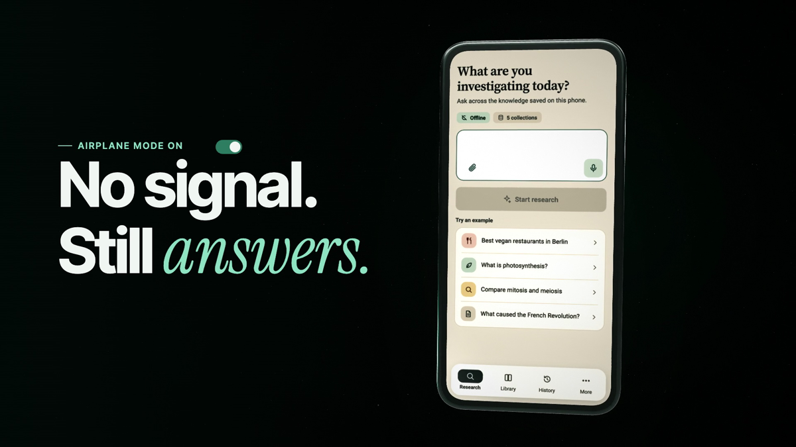

  

<h1 align="center">Field Atlas</h1>

Research, explore, and question the knowledge on your phone—even offline.

  <strong><a href="https://github.com/0x94t3z/fieldatlas/releases/download/v1.4.0/fieldatlas.apk">Download for Android</a></strong> ·
  <a href="#watch-it-work">Demo</a> ·
  <a href="#for-developers-and-data-builders">Docs</a> ·
  <a href="https://github.com/0x94t3z/fieldatlas">Source</a>

  
  
  
  
  
  
  

<a href="https://github.com/0x94t3z/fieldatlas/releases/tag/v1.4.0">v1.4.0 · Release</a> · Works offline after setup · No account required

---

Field Atlas runs a language model on the phone. You can also add local knowledge collections; when one contains a relevant passage, the answer can show a numbered citation that opens that passage. There is no account, search API, remote inference, or Google Play Services requirement. User-started downloads and catalog refresh require internet access; research uses installed files.

## At a glance

| | What it means |
| --- | --- |
| **Works offline** | Questions, local search, and answer generation stay on the device. Download or transfer the files you need *before* going offline. |
| **Model first** | Download the default model or import a compatible `.fapack`. General questions can receive an unverified model explanation without a knowledge collection. |
| **Collections are optional** | Download the Encyclopedia, Travel guides, Vegan places, Cryptography & Ethereum or another collection during setup or from Library, or import a compatible knowledge `.fapack`. Collections add searchable passages on their own topics. |
| **Android** | ARM64 phone, Android 13 (API 33) or newer. Tested on a Redmi 13C (6 GB, Android 13) and an Infinix X6840 (4 GB, Android 16). Not yet tested on a Pixel, on GrapheneOS or on any 8 GB phone. |

## Watch it work

Watch the **52-second Field Atlas v1.2.0 film**: an animated walkthrough of the Berlin vegan lookup, a place sheet, voice input, a cited answer and the Library. It is built from screen mockups that match the app, not recorded on a phone. The MP4 is available with the release downloads.

[Watch or download the v1.2.0 demo (MP4, 57 MB)](https://github.com/0x94t3z/fieldatlas/releases/download/v1.2.0/field-atlas-1.2.0-film.mp4).

On a real phone: an [unedited 35-second recording of v1.2.0](docs/evidence/physical/infinix-x6840-android16/field-atlas-1.2.0-offline-berlin.mp4) on a 4 GB Infinix X6840 with airplane mode on. “Best vegan restaurants in Berlin” returns six cited fully vegan places in 10 seconds, and a tap opens the saved listing. [Recording details](docs/evidence/physical/infinix-x6840-android16/README.md#v120-offline-berlin-run-3-october-2026).

## Get started

> **Latest release:** [v1.4.0](https://github.com/0x94t3z/fieldatlas/releases/tag/v1.4.0). Answers can be inaccurate, and collection coverage is limited. Read the [release notes and known limitations](docs/releases/current.md).

On an Android 13+ ARM64 phone:

1. [Download Field Atlas](https://github.com/0x94t3z/fieldatlas/releases/download/v1.4.0/fieldatlas.apk). A [SHA-256 checksum](https://github.com/0x94t3z/fieldatlas/releases/download/v1.4.0/fieldatlas.apk.sha256) is available to verify the APK.
2. Open the APK on your phone and follow Android’s installation prompts.
3. In setup, **download the default model** while online, or **import a saved model `.fapack`**. Wait for verification and installation to finish. A raw `.gguf` or checksum file is not an importable model pack.
4. Optionally download collections such as **Encyclopedia**, **Travel guides**, **Vegan places**, **Essentials**, **Travel places**, **Cryptography & Ethereum** or **Biology & longevity**, or import a saved knowledge `.fapack`. You can add more later in **Library**.
5. Open **Research**, ask a question, and tap **Start research**. If the answer includes numbered citations, open them to inspect the saved passages.

**Install → download or import a model → optionally add knowledge → research offline.**

The APK is about 100 MB; the model and collections require additional downloads and storage. Finish setup before going offline. Model/Biology download recovery has not been independently verified for this release; compatible saved-pack imports remain an alternative.

**Updating a test build?** The public APK cannot update a build signed with the local-test key. Preserve local data before considering a reinstall—uninstalling removes app-private data. See the [installation notes](docs/releases/current.md#installation). For the older v1.1.10 release, use its [version-specific setup guide](https://github.com/0x94t3z/fieldatlas/blob/v1.1.10/docs/installation.md).

## Models, collections, and citations

| File | Required? | What it does | What it cannot prove |
| --- | --- | --- | --- |
| Model `.fapack` | Yes | Generates answers on the phone. | An uncited model answer is not evidence that a claim is true. |
| Knowledge `.fapack` | No | Supplies local passages the app can search and cite. | A citation only supports what its passage actually says. |
| Audio pack | No | Supports optional offline speech input in compatible builds. | It does not add factual knowledge. |

Every collection, with its size, checksum, source, snapshot date and licence, is listed in [DATASETS.md](DATASETS.md#collections-the-app-offers). The app downloads them from Hugging Face ([Knowledge Packs](https://huggingface.co/datasets/0x94t3z/fieldatlas-knowledge), [Encyclopedia](https://huggingface.co/datasets/0x94t3z/fieldatlas-encyclopedia)); you can also save a `.fapack` from there and import it. The [Travel places collection](DATASETS.md#broader-travel-places-keyword-only-builder) contains dated Wikivoyage listings for restaurants, hotels, sights, shops, and other places; Vegan places and Essentials are OpenStreetMap places, searched by distance from the phone. None of them can check today's opening hours, menus, quality, or whether a place still exists. Travel guides are Wikivoyage's guides by section, with its phrasebooks. Biology & longevity is a biology textbook, health topic summaries, ageing gene records and six ageing reviews, not every subject and not medical advice. The Encyclopedia is English and Simple English Wikipedia in one collection (8.39 million passages; 10.64 GB to download, 24.35 GB installed), from snapshots of December 2025 and October 2026, not live information. The 42 emergency guides and the emergency-number table ship inside the app.

General questions may receive an **unverified model explanation** when local evidence is missing. Unsupported source-only requests return an evidence-gap message. A citation is a way to inspect a passage, not proof that an answer is correct; check the passage's wording, context, and date.

## Version status

The bounty's bar is an offline tool "more than 50% as good as internet search plus a frontier AI
model". Field Atlas 1.4.0 was measured against that bar on 60 questions written after the release
build was frozen, by a writer who did not read the repository, each answer graded blind twice against
a frontier model's web-researched answer ([how](docs/evaluation.md#140-release-build-on-fresh-questions-october-13)):
**34% of the reference with the default Qwen3.5 2B**, with 1.02 factual errors per answer. The optional Qwen3.5 4B, offered only to phones with 8 GB of memory, reaches 35% on the 55 questions without a phone position, with about half the factual errors.
Two earlier fresh sets found and fixed a candidate that withheld answers its own review could not
confirm (21%) and near-me place bugs; they are reported as development data. References and
graders are frontier models of one family, so these are development measures, not an independent
score. Every answer and grade is in [docs/fieldtest/results-1.4.0/](docs/fieldtest/results-1.4.0/).

Where the app answers without the model it is strong: places near the phone, Vitalik's "best
vegan restaurants in the city I'm in", casual lookups, emergency guides and numbers, phrasebook
lines and calculations. Where the 2B model writes the explanation itself, it is well below the
reference, and answers that use the model take 2 to 4 minutes on a 6 GB phone.

Hardware: tested on a Redmi 13C (6 GB, Android 13) and an Infinix X6840 (4 GB, Android 16). Not
yet run on a Pixel, on GrapheneOS, or on any 8 GB phone.

| Version | Public download? | What the evidence covers |
| --- | --- | --- |
| [v1.4.0 release](https://github.com/0x94t3z/fieldatlas/releases/tag/v1.4.0) | Yes — signed APK and checksum | App 1.4.0 (19). One Encyclopedia of English and Simple English Wikipedia searched by a native engine, cited explanations reviewed before they are shown, a new Biology & longevity collection, downloads from Hugging Face at pinned revisions, the best vegan restaurants in the city the phone is in, travel guides by section with phrasebooks, 42 emergency guides and the emergency numbers of 242 countries, calculations on the phone, the optional 4B, and the blind field test above. See the [release notes](docs/releases/current.md). |
| [v1.3.0 previous release](https://github.com/0x94t3z/fieldatlas/releases/tag/v1.3.0) | Yes — signed APK and checksum | App 1.3.0 (17). Emergency questions answered from 41 bundled official guides, open-now place answers, Word, PowerPoint and EPUB attachments, and faster answers on low-end phones. Its opening-hours reader followed another submission's parser and was replaced in 1.4.0 ([audit](docs/compliance/release-audit.md#provenance-audit-of-other-submissions-material-5-october-2026)). See its [release notes](docs/releases/field-atlas-1.3.0.md). |
| [v1.2.1 previous release](https://github.com/0x94t3z/fieldatlas/releases/tag/v1.2.1) | Yes — signed APK and checksum | App 1.2.1 (16). Keeps the app alive while a file picker is open (Xiaomi phones killed it), checks attachment answers against the files, and adds the Essentials collection. See its [release notes](docs/releases/field-atlas-1.2.1.md). |
| [v1.2.0 previous release](https://github.com/0x94t3z/fieldatlas/releases/tag/v1.2.0) | Yes — signed APK and checksum | App 1.2.0 (15). Adds Encyclopedia, Travel guides and Vegan places collections, near-me lookups, place cards, source previews and live dictation. See its [release notes](docs/releases/field-atlas-1.2.0.md). |
| [v1.1.10 previous stable release](https://github.com/0x94t3z/fieldatlas/releases/tag/v1.1.10) | Yes | Older features and setup flow. Use the instructions at that tag. |
| Current source / local builds | Build from source | May differ from published artifacts. Local-test signing keys are not compatible with public-release updates. |

The [Farcaster post](https://farcaster.xyz/0x94t3z.eth/0x9538cba8) shows the original public demo. A
useful offline answer on one phone is not an independent quality benchmark or a guarantee for every
Android device.

## Tech stack

| Layer | Technology | Role |
| --- | --- | --- |
| Android app | Kotlin · Jetpack Compose · Material 3 | Native screens and on-device workflows |
| Model runtime | llama.cpp · C++ · JNI | Local language-model inference |
| Local search | SQLite · FTS5 | Search through installed knowledge passages |
| App state | Kotlin Coroutines · Flow | Asynchronous work and reactive UI state |
| Pack tooling | Python · `.fapack` | Build and validate model and knowledge archives |
| Build tooling | Gradle · Android NDK · CMake | Build the app and native runtime |

## Acknowledgements

Part of Field Atlas comes from a fork of this repository,
[github.com/vbuterin/fieldatlas](https://github.com/vbuterin/fieldatlas/tree/vector-search), branch
`vector-search`. Its commits 337d334 to 769e85d (24–25 September 2026, authored in Git as
"user.email &lt;me@me.com&gt;") were merged here in 4967a49. They added:

- multi-collection retrieval with semantic (vector) search and query expansion;
- answer history, and answers that keep generating when the app is in the background;
- voice input with a bundled Vosk English model;
- the deterministic pack toolchain (`content2fapack.py`, `stream_pack.py`, `fapack_convert.py`,
  `build_model_packs.py`, `build_vector_pack.py`, `wiki_mini_build.py`, `wiki_extract_numbers.py`) and
  the end-to-end test tools with their question lists (`e2e_test.py`, `e2e_battery.py`);
- the first version of the llama.cpp generation patch in `scripts/patches/`;
- the Biology & longevity vector pack, which the app still downloads from that fork.

Later work in this repository builds on these parts.

## For developers and data builders

- [Build the Android app](docs/building.md)
- [Recommended model and other model definitions](MODELS.md)
- [Knowledge collections, their sources, and freshness](DATASETS.md)
- [Create your own `.fapack` collection](tools/README.md)
- [Testing, benchmark limits, and physical-device evidence](docs/verification.md)

The app is native Kotlin/Jetpack Compose with a pinned local llama.cpp runtime. The pack tools, tests, and offline-policy checks are in this repository. Large model and collection files are not committed; their sources and checksums are documented so they can be rebuilt or verified.
