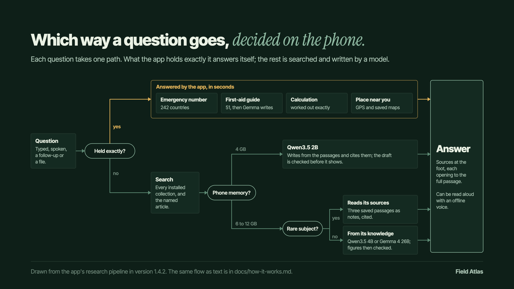
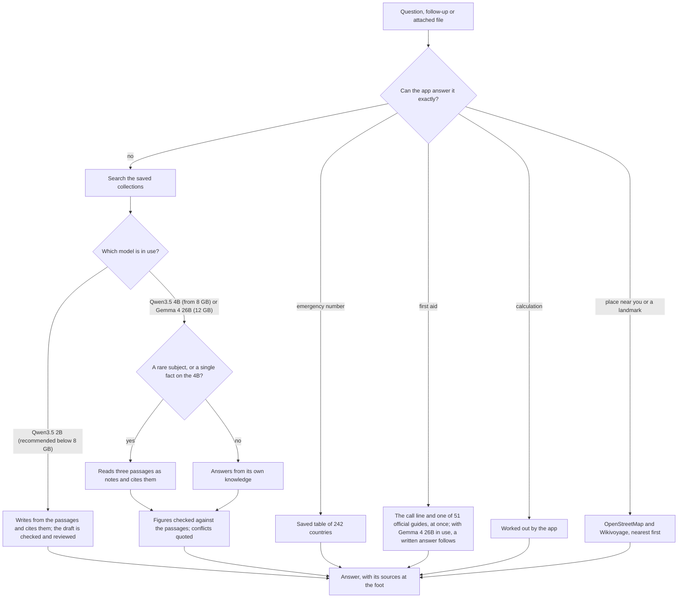
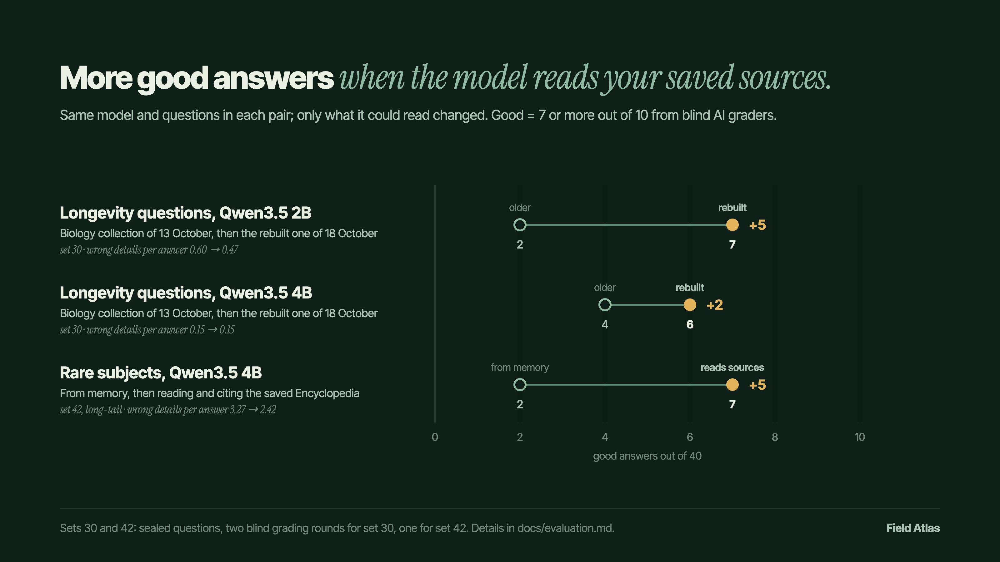
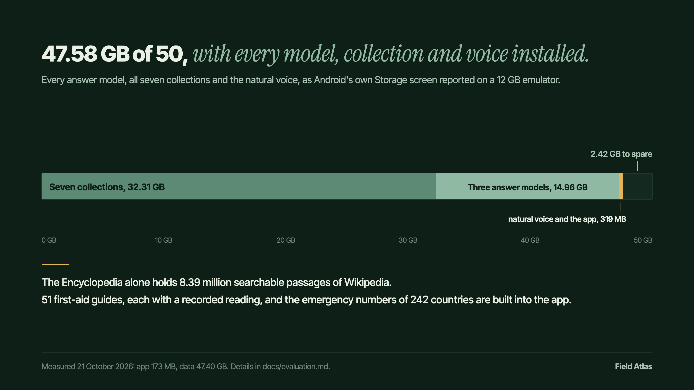

# How Field Atlas answers a question

Everything on this page runs on the phone. The app goes online only when you download a model or a
collection, or refresh the list of collections.

## The flow

The picture above shows the stages every answer passes through. This one shows the decisions: which
way one question goes, and why.

The same flow as a diagram GitHub draws

## 1. Ask

A question can be typed or spoken. A follow-up builds on the answer above it and can read that
answer's passages again. An attached file is read first, and its own text leads the answer.

## 2. Answer directly, when the app knows exactly

Some questions have one right answer that the app already holds. These never reach the model, so
they come back in seconds and the model cannot rephrase them wrongly.

- **Emergency numbers** come from a saved table covering 242 countries.
- **First aid** opens with the call line and one of 51 official guides, shown as published, in
  seconds, even while another answer is being written. When Gemma 4 26B is the model in use (12 GB
  phones) and is free, it then writes an answer for the situation with the guide as its only source,
  which takes minutes; the smaller models never rewrite a guide, because one once reversed an
  instruction while paraphrasing. Where no guide covers the situation, the smaller models say so and give
  no treatment steps for it, only the basics the CPR, recovery-position and anaphylaxis guides support;
  Gemma writes from what it knows.
- **Calculations** such as fuel cost, currency at a given rate or time zones are worked out by the
  app. A word problem that gives all its own figures goes to the model with those figures only, and
  every step it writes is recomputed on the phone.
- **Places near you or near a landmark**, such as a pharmacy, an ATM, a vegan restaurant or a hospital
  near the Colosseum, are found from the phone's position, or from where the travel guide puts the
  landmark, in the OpenStreetMap and Wikivoyage collections, nearest first and within a walk of a
  landmark. Each place is a card with how far and which way, what it is, whether it is open (a
  hospital's line says whether the map records an emergency department) and the guide's own words;
  its sheet shows the address large enough to show a driver. A list of hospitals opens with the
  emergency number to call and the nearest one recorded with an emergency department.

## 3. Search the saved collections

Everything else is searched in the collections you installed. Leviathan, the search engine built
into the app, searches the Encyclopedia's 8.39 million passages and the Biology papers. When the
question names a subject, its article is looked up by title. A travel or phrase question reads the
guide section or phrasebook it asks for. If the first search finds nothing that fits, the model
suggests more search words and the app searches again.

## 4. Write, with the model the phone can hold

Setup recommends a model by the phone's memory; how a question is written depends on the model in use.

| Recommended on | Model | How it writes |
| --- | --- | --- |
| Below 8 GB (any phone can use it) | Qwen3.5 2B | From the passages, citing each one; the draft is checked and reviewed by the model before it shows. A draft that fails is rewritten once; if that fails too, the answer quotes the saved passages or gives a model explanation labelled as unverified. |
| 8 GB or more (a 6 GB phone can choose it, slow there) | Qwen3.5 4B | From its own knowledge; a question for a single fact reads three saved notes first. |
| 12 GB | Gemma 4 26B | Reasons first, then answers from its own knowledge. |

A model answering from its own knowledge knows well-known subjects better than the passages say
them, and invents details about subjects few people write about. So when a subject is rare in the
saved collections, the model reads three saved passages about it as notes and cites them. A subject
counts as rare when the question names it, when it has no article in Simple English Wikipedia, and
when it appears in at most 400 saved passages. A question led by a specialist collection, such as
Biology or Cryptography, or by a collection you imported yourself, also counts.

Qwen3.5 4B also reads three notes for a question that asks for one fact (who designed, when did, what
year, how tall, how deep, what is the capital of), when the Encyclopedia leads the passages found:
from memory it slips on dates and figures. On 105 earlier sealed fact questions whose answer this changed, graded with the two answers side by side,
it took the 4B from 38 to 66 good answers ([details](testing-1.4.2.md#facts-from-the-saved-encyclopedia-4b)).
Gemma 4 26B reasons before it answers and keeps to its knowledge. A question about the asker's own
plans, or a follow-up such as "how much does that cost?", stays with memory.

## 5. Check and show

Before you read an answer written from memory, the app compares it with the saved passages. A
figure or date that a passage also states is marked with that passage's number. Where a passage
gives a different figure for what was asked, its sentence is quoted under the answer. One line at
the end says where the answer came from and what was checked: "From the model's knowledge; 2 figures
match your sources", "… not checked against your sources" when no figure could be compared, or
"… nothing saved on this phone covers it". The sources sit at the foot of the screen, and each opens
to the full passage. Any answer can be read aloud with an offline voice.

## Measured results

We count how many questions get a good answer, one that blind AI graders score 7 or more out of
10 in every round, and how many problems the graders list per answer (grader annotations); the
model figure also gives the average score as a share of web-researched reference answers' score, a
judge's average rather than a share of correct answers. These are runs of the app's own answering code
on a computer, 19 to 23 October: the 4B was measured before it read notes for single facts, and the 2B's
last three sets were graded a day after the others. The tests and their records are in
[the evaluation](evaluation.md) and [How Field Atlas 1.4.2 was tested](testing-1.4.2.md).

## Where it lives in the code

| Step | Code |
| --- | --- |
| The whole flow, in order | [ResearchOrchestrator.kt](../app/src/main/java/xyz/fieldatlas/research/ResearchOrchestrator.kt) |
| Emergency numbers and guides | [EmergencyNumbers.kt](../app/src/main/java/xyz/fieldatlas/emergency/EmergencyNumbers.kt), [EmergencyGuideMatch.kt](../app/src/main/java/xyz/fieldatlas/emergency/EmergencyGuideMatch.kt) |
| Calculations and word problems | [Calculators.kt](../app/src/main/java/xyz/fieldatlas/research/Calculators.kt), [WordProblem.kt](../app/src/main/java/xyz/fieldatlas/research/WordProblem.kt) |
| Places near you or a landmark | [VenueLookup.kt](../app/src/main/java/xyz/fieldatlas/research/VenueLookup.kt) |
| Search across collections | [MultiKnowledgeRetriever.kt](../app/src/main/java/xyz/fieldatlas/research/MultiKnowledgeRetriever.kt), [SubjectLookup.kt](../app/src/main/java/xyz/fieldatlas/research/SubjectLookup.kt), [QueryExpansion.kt](../app/src/main/java/xyz/fieldatlas/research/QueryExpansion.kt) |
| Model per phone | [ModelOffers.kt](../app/src/main/java/xyz/fieldatlas/assets/ModelOffers.kt) |
| Prompts | [PromptBuilder.kt](../app/src/main/java/xyz/fieldatlas/research/PromptBuilder.kt) |
| Rare subjects and single facts | [SourceRouter.kt](../app/src/main/java/xyz/fieldatlas/research/SourceRouter.kt) |
| Cited drafts and their checks | [CitedExplanation.kt](../app/src/main/java/xyz/fieldatlas/research/CitedExplanation.kt) |
| Figures checked against passages | [SavedFactCheck.kt](../app/src/main/java/xyz/fieldatlas/research/SavedFactCheck.kt) |
| The answer screen | [AnswerScreen.kt](../app/src/main/java/xyz/fieldatlas/ui/research/AnswerScreen.kt) |
| Reading aloud | [ReadAloud.kt](../app/src/main/java/xyz/fieldatlas/speech/ReadAloud.kt) |

The images are drawn by [tools/charts/make_charts.py](../tools/charts/make_charts.py) from the
figures in [tools/charts/charts.json](../tools/charts/charts.json), and the animated README hero, in a light and a dark
version, by [tools/charts/make_hero.py](../tools/charts/make_hero.py).
